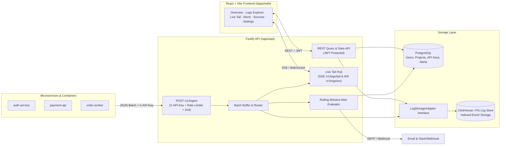

# LogFlow — Centralized Log Intelligence Platform

LogFlow is a full-stack centralized logging platform where engineering teams ingest structured logs from many services into one place, then search, filter, live-tail, and alert on them in real time.

---

## Architecture



---

## Quickstart & Setup

### 1. Install Dependencies
```bash
npm install
```

### 2. Optional: Start PostgreSQL & ClickHouse via Docker Compose
```bash
cp .env.example .env
docker compose up -d
```
> **Note:** If Docker is not running locally, LogFlow automatically uses an embedded persistent PostgreSQL instance (`@electric-sql/pglite` stored in `apps/api/.data/pgdata`) with the exact same SQL schema and `PostgresLogAdapter` so you can run and test the entire stack with zero external dependencies.

### 3. Build Shared Package & Seed Realistic Data
```bash
npm run build
npm run seed
```
The seed script creates:
- **Demo Admin Account**: `alex@logflow.dev` / `password123`
- **Demo Project**: `Production Core` (`prj_production_core`)
- **Demo Ingestion API Key**: `lf_live_demo_production_key_9f8a7b6c5d4e3f2a1b0c`
- **320+ Realistic Log Events** across `auth-service`, `payment-api`, `api-gateway`, `order-worker`, `notification-svc`, and `search-indexer`.

### 4. Start API & Web App
```bash
# Terminal 1 — Fastify API on http://localhost:4000
npm run dev:api

# Terminal 2 — React + Vite Web App on http://localhost:5173
npm run dev:web
```

### 5. Run Unit & Integration Tests
```bash
npm test
```

---

## Search Query Syntax

In **Logs Explorer** and **Live Tail**, use structured search tokens combined with free-text phrases:

| Syntax | Description | Example |
| :--- | :--- | :--- |
| `level:<lvl>` | Filter by one or more comma-separated levels (`trace`, `debug`, `info`, `warn`, `error`, `fatal`) | `level:error,fatal` |
| `service:<name>` | Filter by service name | `service:auth-service` |
| `trace:<id>` | Filter by distributed trace ID | `trace:tr-2710-9f2b` |
| `<key>:<value>` | Filter by JSON metadata field | `env:prod region:us-east-1` |
| `"<phrase>"` | Exact phrase match in message or metadata | `"token expired"` |

Combined example:
```text
level:error service:auth "token expired" env:prod
```

---

## API Reference

### 1. Ingestion (`POST /v1/ingest`)
Authenticates via `X-API-Key` header, rate-limits per key, validates with Zod, and writes batches.

- **Headers**:
  - `Content-Type: application/json`
  - `X-API-Key: lf_live_demo_production_key_9f8a7b6c5d4e3f2a1b0c`
- **Request Body**:
  ```json
  [
    {
      "timestamp": "2026-10-30T14:02:11.482Z",
      "level": "error",
      "service": "payment-api",
      "message": "timeout after 30s calling ledger",
      "trace_id": "tr-99812a",
      "metadata": { "region": "eu-west-1", "retry_attempt": 2 }
    }
  ]
  ```
- **Response (`202 Accepted`)**:
  ```json
  {
    "accepted": 1,
    "project_id": "prj_production_core",
    "ids": ["evt_48a9c10291b3f821"]
  }
  ```

### 2. Authentication
- `POST /v1/auth/register` — `{ name, email, password }` → `{ token, user }`
- `POST /v1/auth/login` — `{ email, password }` → `{ token, user }`
- `GET /v1/auth/me` — Bearer JWT → `{ user }`

### 3. Logs & Overview Metrics
- `GET /v1/logs?projectId=...&q=...&level=...&service=...&from=...&to=...&limit=50&offset=0`
- `GET /v1/logs/stats?projectId=...&rangeHours=24`
- `GET /v1/logs/tail?projectId=...&q=...&token=...` (Server-Sent Events stream)
- `GET /v1/logs/ws?projectId=...&q=...&token=...` (WebSocket stream)

### 4. Projects, API Keys & Team
- `GET /v1/projects` / `POST /v1/projects` / `PATCH /v1/projects/:id`
- `GET /v1/projects/:id/keys` / `POST /v1/projects/:id/keys` / `DELETE /v1/projects/:id/keys/:keyId`
- `GET /v1/team` / `POST /v1/team` / `PATCH /v1/team/:userId` / `DELETE /v1/team/:userId`

### 5. Alerts
- `GET /v1/alerts/rules?projectId=...`
- `POST /v1/alerts/rules`
- `PATCH /v1/alerts/rules/:id`
- `DELETE /v1/alerts/rules/:id`
- `GET /v1/alerts/history?projectId=...`

